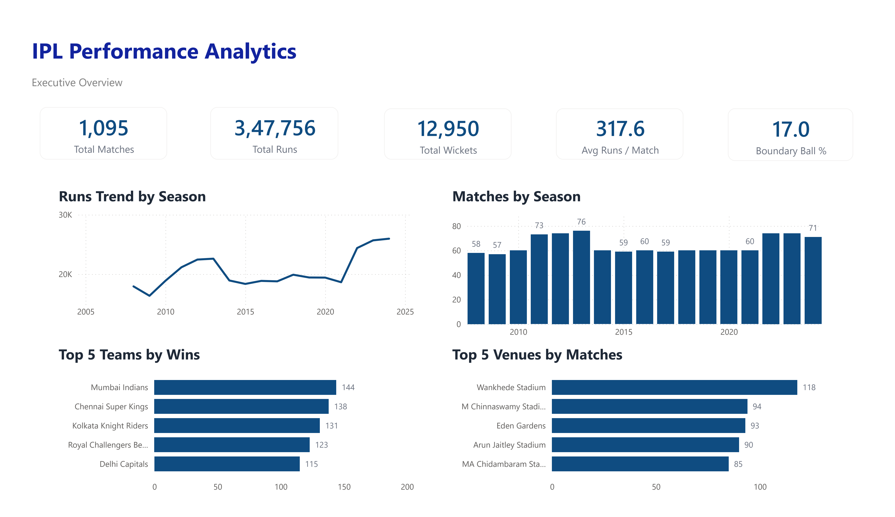
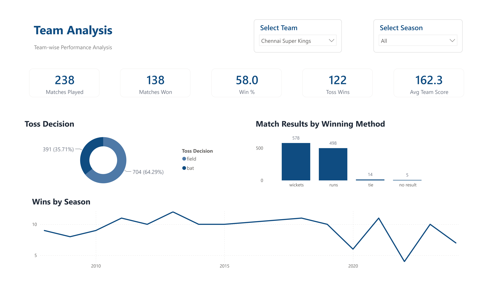
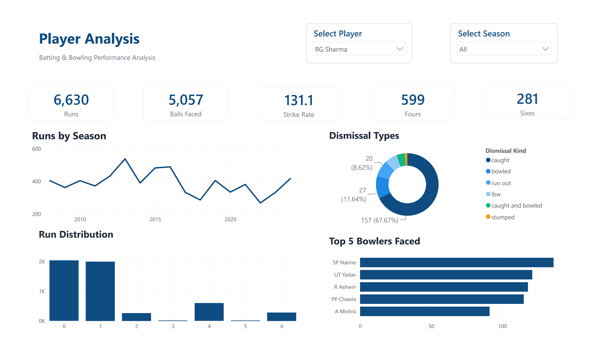

# IPL Performance Analytics

An end-to-end IPL analytics portfolio project combining Python-based exploratory analysis with an interactive Power BI dashboard.

The project uses match-level and ball-by-ball data from 17 IPL seasons (2008–2024) to explore team performance, batting, bowling, venue patterns, and league-level trends.

## Project Overview

This repository brings together two existing pieces of work:

- **Python analysis:** data understanding, cleaning, team analysis, batter analysis, bowler analysis, venue analysis, and consolidated insights.
- **Power BI dashboard:** an interactive report with Executive Overview, Team Analysis, and Player Analysis pages.

The current repository is an organized consolidation of the existing work. Improvements to reproducibility, metric validation, and documentation will be made after the combined project has been checked locally.

## Repository Structure

```text
IPL-Performance-Analytics/
│
├── data/
│   ├── raw/
│   │   ├── matches.csv
│   │   └── deliveries.csv
│   │
│   └── cleaned/
│       ├── matches_clean.csv
│       └── deliveries_clean.csv
│
├── notebooks/
│   ├── 01_data_understanding.ipynb
│   ├── 02_data_cleaning.ipynb
│   ├── 03_team_analysis.ipynb
│   ├── 04_batter_analysis.ipynb
│   ├── 05_bowler_analysis.ipynb
│   ├── 06_venue_analysis.ipynb
│   └── 07_final_insights.ipynb
│
├── powerbi/
│   ├── IPL_Performance_Analytics.pbix
│   └── screenshots/
│       ├── Executive_Overview.png
│       ├── Team_Analysis.png
│       └── Player_Analysis.png
│
├── README.md
├── LICENSE
├── requirements.txt
└── .gitignore
```

## Dataset

The project contains two datasets at different levels of detail:

| Dataset | Grain | Rows |
|---|---|---:|
| `matches.csv` | One row per IPL match | 1,095 |
| `deliveries.csv` | One row per ball/delivery record | 260,920 |

The `cleaned` directory contains the cleaned versions used by the existing analysis and Power BI report.

The data covers 17 seasons, from 2008 through 2024. The cleaned match data contains 15 standardized franchise names and 37 venues.

**Data note:** Missing values in delivery-level fields such as dismissal details and extras are often structural. They should not be treated as a reason to drop delivery rows. The raw delivery file also contains trailing metadata/comment rows and numeric team identifiers; the ingestion and mapping logic must account for these when reproducing the cleaned dataset from raw data.

## Python Analysis

The notebooks are arranged in the order of the existing analysis workflow:

1. **Data Understanding** (`01_data_understanding.ipynb`)  
   Inspects dataset shape, columns, data types, missing values, and unique values.

2. **Data Cleaning** (`02_data_cleaning.ipynb`)  
   Investigates missing values and standardizes team and venue names.

3. **Team Analysis** (`03_team_analysis.ipynb`)  
   Examines wins, win percentages, toss outcomes, chasing performance, and home/away performance.

4. **Batter Analysis** (`04_batter_analysis.ipynb`)  
   Examines run scoring, strike rate, boundaries, consistency, and a composite batter impact score.

5. **Bowler Analysis** (`05_bowler_analysis.ipynb`)  
   Examines wickets, economy, bowling strike rate, dot balls, death-over performance, and a composite bowler impact score.

6. **Venue Analysis** (`06_venue_analysis.ipynb`)  
   Examines scoring patterns and match outcomes across venues.

7. **Final Insights** (`07_final_insights.ipynb`)  
   Consolidates findings from the analysis notebooks.

Composite Impact Scores are custom weighted analytical measures. They are not official IPL ratings and should be interpreted in the context of their selected inputs, weights, and eligibility filters.

## Power BI Dashboard

The Power BI report is located at:

`powerbi/IPL_Performance_Analytics.pbix`

It currently contains three report pages:

### 1. Executive Overview

League-wide KPIs and season-level trends, including matches, runs, wickets, average runs per match, boundary frequency, team wins, and venue usage.



### 2. Team Analysis

Team-level performance with team and season filtering, including matches played, wins, win percentage, toss decisions, match results, and wins by season.



### 3. Player Analysis

Player-level batting analysis with player and season filtering, including runs, balls faced, strike rate, fours, sixes, dismissal types, run distribution, and bowlers faced.



The `.pbix` file is the editable Power BI report. The PNG files are static previews for viewing the report directly on GitHub.

## Tools and Technologies

- Python
- Pandas
- NumPy
- Matplotlib
- Seaborn
- Jupyter Notebook
- Microsoft Power BI Desktop
- Power Query
- DAX

## Setup

### 1. Clone the repository

```bash
git clone https://github.com/varungodhani11/IPL-Performance-Analytics.git
cd IPL-Performance-Analytics
```

### 2. Create and activate a virtual environment (recommended)

```bash
python -m venv .venv
```

On Windows:

```bash
.venv\Scripts\activate
```

### 3. Install dependencies

```bash
pip install -r requirements.txt
```

### 4. Open the notebooks

```bash
jupyter notebook
```

Run the notebooks in numerical order. Keep the repository folder structure unchanged because notebooks use relative file paths.

### 5. Open the Power BI report

Open `powerbi/IPL_Performance_Analytics.pbix` in Power BI Desktop.

If Power BI asks for the CSV source locations, point the queries to:

- `data/cleaned/matches_clean.csv`
- `data/cleaned/deliveries_clean.csv`

Then refresh the report and verify the visuals and slicers.

## Important Metric Definitions

- **Runs:** Total runs recorded, including extras where the relevant calculation uses `total_runs`.
- **Strike Rate:** Runs scored per 100 balls faced.
- **Economy Rate:** Runs conceded per six legal balls, subject to the calculation used in the notebook.
- **Wickets:** A delivery-level dismissal event is not necessarily a bowler-credited wicket. Run outs and other non-bowler dismissals must be treated separately.
- **Boundary Ball Percentage:** The denominator must be stated clearly. A percentage calculated over balls faced excluding wides differs from one calculated over all delivery records.

Metric definitions and calculations should be checked against the notebook and Power BI measure implementations before using the results for decisions or external claims.

## Current Scope and Limitations

This combined repository preserves the existing Python notebooks, cleaned datasets, Power BI report, and dashboard screenshots. It does not claim that every analysis is fully reproducible from the raw files yet.

Items to validate during the next project stage include:

- Reproducing the cleaned delivery data from raw data, including metadata-row handling and numeric team-ID mapping.
- Checking notebook relative paths after consolidation.
- Reviewing chasing-team identification and home/away/neutral-venue logic.
- Validating death-over calculations against the dataset's over numbering.
- Confirming Power BI data-source paths, relationships, DAX measures, and slicer behavior.
- Confirming the original dataset source and its redistribution terms.

## Author

**Varun Godhani**

- GitHub: [varungodhani11](https://github.com/varungodhani11)
- LinkedIn: [linkedin.com/in/varungodhani](https://linkedin.com/in/varungodhani)
